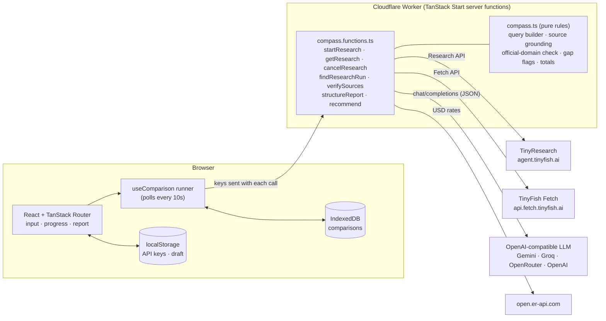
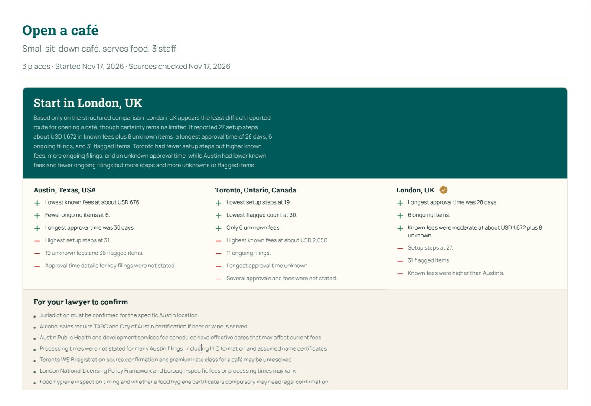
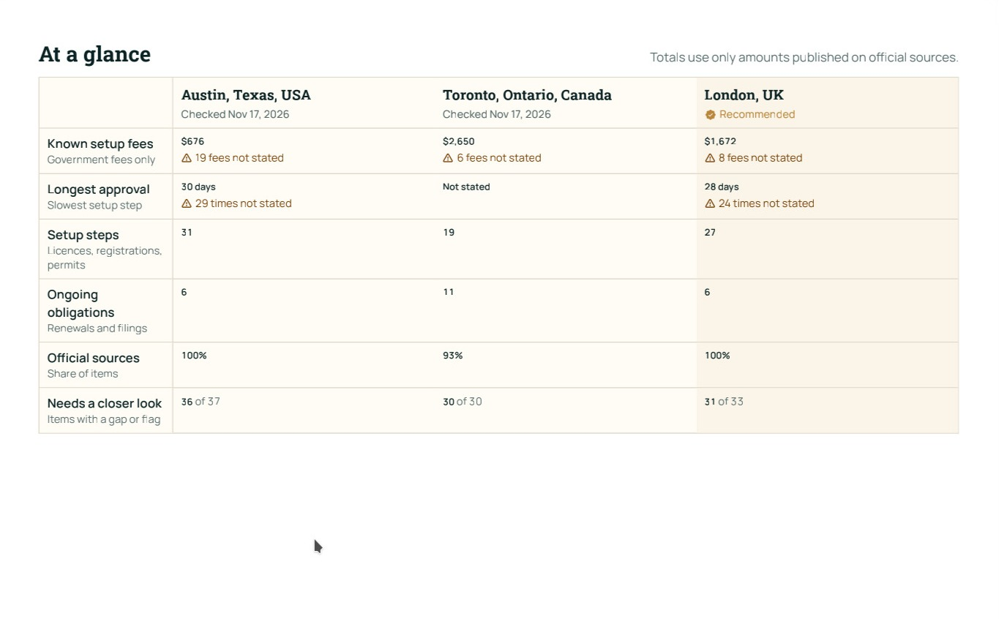
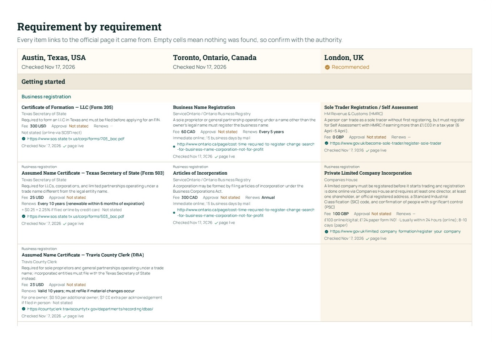

<p align="center">
  
</p>

<h1 align="center">TinyCompass</h1>

<p align="center">
  <strong>Where should I set up?</strong><br />
  One activity, three or more places. Every licence, filing, fee and approval time, pulled live from official government sites and lined up side by side.
</p>

---

## Project summary

Opening a café, registering a company or running a drone business takes very different paperwork depending on where you do it. TinyCompass takes **one activity** and **at least three places** (cities, states or countries) and returns:

- **Every requirement for each place**, sorted into the same 10 categories so they line up across places: business registration, tax registration, activity licence, zoning and premises, health and safety, permits and certifications, insurance, employer registration, renewals, and ongoing filings.
- **A side-by-side comparison** of setup steps, known government fees, time to approval, renewals and ongoing filings.
- **A source link for every item**, the date it was checked, and whether the page was live at that time.
- **A recommendation** for where it's easiest to start, with each place's pros and cons and a list of points for a lawyer to confirm.
- **Flags for gaps instead of guesses.** A fee, approval time or source that isn't published on an official site shows as "Not stated" or gets a flag. It is never estimated.

It works for any activity and any place, with nothing hardcoded. It only explains what is *required* to start; it does not check whether any person or business holds a licence.

There is no backend database and no login. Comparisons are saved in your browser (IndexedDB), and API keys are saved in your browser (localStorage) and sent with each request. Nothing is stored on a server.

## How TinyFish is used

**TinyResearch** does the core work: one deep research run per place. **TinyFish Fetch** then re-checks every source the research cited.

| Endpoint | Where | What it's used for |
| --- | --- | --- |
| `POST /v1/automation/run-research-async` | `startResearch` | Starts one **deep** research run per place. The query asks for every licence, registration, permit and filing in all 10 categories, with exact name, issuing authority, official fee, processing time, renewal frequency and the official URL. It tells the research to write "not stated" instead of estimating, and not to look up whether anyone holds a licence. A `domain_filter` gives priority to government domains (`.gov`, `.gov.uk`, `.gc.ca`, `.gob.mx`, `.go.jp` and so on), and the query is kept under the 2,000-character limit. |
| `GET /v1/research-run/{id}` | `getResearch` | Polled every 10 seconds. Returns the run status (`QUEUED`, `RUNNING`, `COMPLETED`, `FAILED`, `CANCELLED`, `TIMED_OUT`), the final report and its citations. The app also reads the run's research plan, evidence and pass count to show live progress: the question being researched, how many sources have been read, and which government sites they came from. |
| `POST /v1/research-run/{id}/cancel` | `cancelResearch` | Backs the **Cancel** and **Cancel all** buttons. Per TinyFish's docs, cancelled runs aren't charged. |
| `GET /v1/research-run?created_after=…` | `findResearchRun` | Starting a run isn't safe to repeat, so the app saves a "start requested" time before calling start. If the page is refreshed mid-start, it finds the run that was already created instead of starting a second, billed one. |
| `POST https://api.fetch.tinyfish.ai` | `verifySources` | After the report is turned into structured requirements, every source URL is fetched again in batches of 10. Each requirement gets a "page live" result and a `checked_at` date, which is the "date it was checked" shown on every item. |

The research only uses links that TinyResearch actually found. After an OpenAI-compatible model turns the report into structured JSON, any source URL that doesn't appear in the TinyResearch report or citations is dropped, and the item is flagged "No source link". Since the model can't add sources, it can't make one up.

If TinyFish is at its concurrent-run limit (`429`) or temporarily busy (`503`), that place waits and starts when a slot opens instead of failing. TinyFish Search and Agent aren't used: TinyResearch already runs its own searches and page reads, and Fetch covers re-checking the sources.

All TinyFish code lives in [`src/lib/compass.functions.ts`](src/lib/compass.functions.ts).

## How it works

1. **Input.** Enter an activity, three to six places, and optional details such as size, staff or premises. Your typing is saved, so a refresh doesn't lose it.
2. **Research (TinyResearch).** One deep run starts per place, all in parallel. Each place shows a four-step tracker (Start, Research, Line up, Verify), live research details and elapsed time. You can cancel a single place or all of them, and progress survives refreshes.
3. **Line up (your AI model).** Once a report is complete, an OpenAI-compatible model sorts it into the 10 categories as strict JSON. Values that aren't in the report stay `null`, and links that aren't in the report or citations are removed.
4. **Verify (TinyFish Fetch).** Every source page is fetched again to confirm it's live and to record the date it was checked.
5. **Flag gaps (pure rules, [`src/lib/compass.ts`](src/lib/compass.ts)).** Each item is checked:
   - Is the source an official government domain?
   - Is the page reachable?
   - Is a fee stated?
   - Is an approval time stated?

   Anything missing is flagged and left blank.
6. **Compare and recommend.** Known fees are totalled, and converted to USD where an exchange rate is available. Unknown fees are counted separately, never treated as zero. Once every place finishes, the model writes a recommendation from the structured comparison only, with each place's pros and cons and a list of points for a lawyer to confirm.
7. **Hand-off.** Export the comparison as CSV or JSON, or print it to PDF. The PDF is laid out for paper: each section starts on a new page and breaks fall between requirements.

## High-level architecture



- **Bring your own keys.** Keys live only in your browser and are passed with each server call. They are never stored on the server.
- **State machine per place:** `queued → researching → structuring → verifying → done`, or `failed` / `cancelled`. Every change is written to IndexedDB, so a refresh resumes where it left off.
- **Pure, tested rules.** The official-source check, gap flags, totals, research query and source grounding are plain functions in `src/lib/compass.ts`, covered by `src/lib/compass.test.ts`.
- **Hosting.** The app runs on Cloudflare Workers through Nitro's `cloudflare-module` preset, and the bundle fits the free plan.

```
src/
├── routes/
│   ├── index.tsx           # activity + places form, demos
│   ├── c.$id.tsx           # progress, recommendation, comparison report, exports, print layout
│   ├── history.tsx         # saved comparisons, JSON import
│   └── settings.tsx        # TinyFish + AI model keys, OpenRouter free-model switch
├── components/PlaceProgress.tsx   # stage tracker, live research info, cancel
├── lib/
│   ├── compass.functions.ts  # server functions: TinyFish, LLM, FX
│   ├── compass.ts            # pure rules (tested)
│   ├── useRunner.ts          # per-place pipeline, polling, cancel, refresh recovery
│   └── storage.ts            # IndexedDB + localStorage helpers
└── styles.css               # theme, motion, report and print styles
```

## Project setup

**You'll need:**
- **Node.js 22.12+** and npm. This is the minimum for Vite 8 and Wrangler 4.
- **A TinyFish API key** from [agent.tinyfish.ai](https://agent.tinyfish.ai/api-keys), with Research enabled on the account. Per TinyFish's pricing, the first 2 completed research runs each UTC day are free, then $2 per deep run. Each place uses one run.
- **An OpenAI-compatible model key.** Presets are built in for Google Gemini (free tier), Groq (free tier), OpenRouter and OpenAI. OpenRouter has a **Free models only** switch, which uses `openrouter/free` to send each request to an available free model.

**Run locally:**

```sh
git clone https://github.com/GxAditya/Tinycompass.git
cd Tinycompass
npm install
npm run dev
```

Open the local URL that Vite prints, go to **API keys**, add your TinyFish key and AI model key, then start a comparison or pick **Try a demo**.

**Checks:**

```sh
npm test            # vitest: rules for official sources, gap flags, totals, query length, source grounding
npx tsc --noEmit    # typecheck
npm run build       # production build (Cloudflare Workers)
```

**Deploy (Cloudflare Workers):**

```sh
npm run preview      # build and run the Worker locally
npm run deploy       # build and deploy with Wrangler
```

## Demo

Comparing **"Open a café"** in Austin (Texas, USA), Toronto (Ontario, Canada) and London (UK).

**Recommendation:** where to start, each place's pros and cons, and points for your lawyer to confirm.



**At a glance:** known fees, the longest approval, setup steps and ongoing obligations side by side, with unpublished values counted instead of guessed.



**Requirement by requirement:** every item with its authority, fee, approval time, renewal, official source link and the date it was checked.



**Full report (PDF):** [`Output/output.pdf`](Output/output.pdf)

---

<p align="center"><sub>TinyCompass is a starting point for a qualified lawyer to confirm. It is not legal advice.</sub></p>
